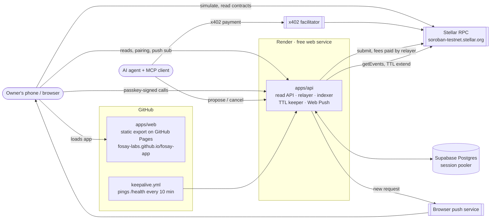

# Hosting FOSAY

Where each piece runs, why, and how to stand it up. Testnet, free tiers, about 20 minutes.

## Topology



The web app talks to Stellar RPC directly for reads and simulation. Everything it signs
goes through the API's relayer, which pays the network fee. The agent never needs the web
app.

## Why each piece lives where it does

| Piece | Host | Why |
|---|---|---|
| `apps/web` | **GitHub Pages** (static export) | The app is entirely client-side: passkeys, simulation and decoding run in the browser. A static site needs no server, is always on, is free, and deploys from this repo's Actions with no extra account. |
| `apps/api` | **Render** free web service | Long-running process: the indexer polls every 5 s, the keeper runs hourly, the relayer holds a funded key. Render runs it from `render.yaml` with no Dockerfile. |
| Postgres | **Supabase** free | Render's free Postgres is deleted 30 days after creation. Neon's free plan caps compute at 100 CU-hours a month, which an always-polling indexer (about 186 CU-hours at 0.25 CU) would exceed. Supabase's free plan has no compute-hour cap. |
| Keep-alive | **GitHub Actions** cron | Render's free instance stops after 15 minutes without inbound requests, and a stopped instance doesn't index or send push notifications. One always-on service is about 744 hours a month, within Render's 750 free hours. |

Put Render and Supabase in the same region (the Blueprint uses `virginia`; pick Supabase
**East US (North Virginia)**). For Frankfurt, change `region` in `render.yaml` to
`frankfurt` and pick Supabase **Central EU (Frankfurt)**.

## Set it up

### 1. Generate the API's secrets (your machine)

```bash
pnpm install
pnpm --filter @fosay/api secrets
```

This creates two testnet accounts (relayer and keeper, which must differ), funds them with
Friendbot and creates VAPID keys for push. It prints four `KEY=value` lines and writes
nothing to disk. Keep the terminal open for step 3.

### 2. Create the database (Supabase)

1. supabase.com → New project. Region **East US (North Virginia)**. Save the database password.
2. Project → **Connect** → **Session pooler** (IPv4; Render has no outbound IPv6). Copy the URI.
3. Replace `[YOUR-PASSWORD]` with the password and add `?sslmode=require` at the end:
   `postgresql://postgres.<ref>:<password>@aws-0-us-east-1.pooler.supabase.com:5432/postgres?sslmode=require`

Use the session pooler, not the transaction pooler: the API uses prepared statements.
The API creates its tables on start.

### 3. Create the API (Render)

1. render.com → **New** → **Blueprint** → connect `fosay-labs/fosay-app`. Render reads `render.yaml`.
2. Fill the five secrets it asks for: `DATABASE_URL` (step 2) and `RELAYER_SECRET`,
   `KEEPER_SECRET`, `VAPID_PUBLIC_KEY`, `VAPID_PRIVATE_KEY` (step 1).
3. **Apply**. The first build takes a few minutes. When it is live, open
   `https://<service>.onrender.com/health`. It should answer `{"ok":true,"network":"testnet","indexedLedger":…}`.

If the name `fosay-api` is taken, Render adds a suffix. Use the URL Render shows.

### 4. Point the web app and keep-alive at the API (GitHub)

1. `fosay-app` → Settings → Secrets and variables → Actions → **Variables** → New variable
   `FOSAY_API_URL` = the Render URL, without a trailing slash.
2. Actions → **Deploy web app to GitHub Pages** → Run workflow. The API URL is built into the
   static files, so the site must be rebuilt whenever it changes.
3. The keep-alive workflow starts on its own once the variable exists.

### 5. Check it

Open <https://fosay-labs.github.io/fosay-app/>, create a wallet, connect an agent with
`fosay-agent keygen` / `pair`, and turn on notifications. The README's testnet walkthrough
lists what each step should show.

## What the free setup costs you

| Limit | Effect | Fix |
|---|---|---|
| Render free: cold start about 1 minute after any stop | First request after a deploy is slow | Starter instance ($7/month at time of writing); delete `keepalive.yml` |
| GitHub cron can run late and stops after 60 days with no repo activity | The instance can sleep; when it wakes, the indexer catches up from its cursor | Same as above |
| Indexer catch-up is limited by RPC event retention (about 7 days on testnet) | Events older than that are missed after a long outage | Keep the service up; a backfill job is a tracked issue |
| Rate limits are in memory | They reset on restart and don't work across instances | Fine for one instance |
| Supabase free: 500 MB, project pauses after a week with no database activity | The indexer writes continuously, so it doesn't pause while the API runs | Pro plan for production |

## Things to get right

- **Passkeys are bound to the domain.** A passkey created on `fosay-labs.github.io` only works
  there. Moving to a custom domain later means owners must add a passkey for the new domain
  (as a signer on rule 0) **from the old domain first**. Choose the final domain before mainnet.
- **The API URL is fixed at build time.** If the web app calls the wrong API, fix the
  `FOSAY_API_URL` variable and rebuild. Changing the API's environment does nothing for the web app.
- **CORS.** `CORS_ORIGIN` is an origin (`https://fosay-labs.github.io`), never a URL with a path.
- **Client IPs.** Relayer rate limits use the rightmost `X-Forwarded-For` entry
  (`TRUSTED_PROXY_HOPS=1`), which a client cannot forge. If every request is limited as one
  address, set `CLIENT_IP_HEADER` to the header your host sets for the real client (for
  example `cf-connecting-ip`). Check the host's documentation before trusting a header.
- **Relayer and keeper balances.** Both pay fees from testnet XLM. Watch them in the logs
  (`fee` on every submission) and top up with Friendbot.
- **No response headers on Pages.** GitHub Pages can't set `X-Frame-Options` and similar
  headers; `next start` does (see `next.config.ts`). A host with header support is a
  pre-mainnet item.

## Running the same layout locally

```bash
FOSAY_STATIC_EXPORT=1 NEXT_PUBLIC_BASE_PATH=/fosay-app NEXT_PUBLIC_API_URL=http://127.0.0.1:8787 pnpm --filter @fosay/web build
```

This writes the static site to `apps/web/out`. Serve it under `/fosay-app/` on another
origin and set the API's `CORS_ORIGIN` to that origin. On 2026-11-09 this layout passed the
full testnet walkthrough: the API ran from a clean clone with the Blueprint's exact build
and start commands, and the site was served under `/fosay-app/` from a different origin.
